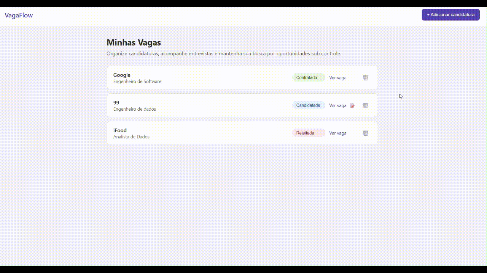

# Rastreador de Vagas

Acompanhe suas candidaturas a vagas de emprego por etapa do processo seletivo — sem perder o fio da meada em planilhas.



---

## O problema

Quem está procurando emprego se candidata a dezenas de vagas em pouco tempo — LinkedIn, Gupy, indicação, site da empresa. Em poucas semanas aparecem as perguntas que ninguém consegue responder de cabeça:

- Eu já me candidatei nessa empresa?
- Em que etapa está aquele processo de duas semanas atrás?
- Onde estava o link daquela vaga que eu queria revisar antes da entrevista?
- O que eu anotei sobre a conversa com o recrutador?

A solução comum é uma planilha, que logo fica desatualizada: dá trabalho preencher, é fácil duplicar linhas e não existe nenhuma regra impedindo que você escreva "em andamento" numa linha e "Em Processo" na outra.

Este projeto resolve isso com um lugar único para registrar cada candidatura e mover a vaga entre as etapas em um clique:

**Candidatada → Em Processo → Proposta → Contratada / Rejeitada**

Cada vaga guarda empresa, cargo, link original, fonte (de onde veio) e anotações livres. As etapas são validadas no backend, então o histórico fica consistente — não existe status inventado no meio do caminho.

---

## Tecnologias e por que cada uma

### Python
Escolhi Python pela legibilidade. As regras de negócio do projeto — quais campos são obrigatórios, quais etapas existem, o que acontece quando uma vaga é criada — ficam em `backend/regras.py` e podem ser lidas de cima a baixo como texto. Isso importa num projeto que vai crescer: a regra precisa ser óbvia para quem abre o arquivo depois, inclusive para mim mesma em alguns meses.

Python também tem um ecossistema maduro de testes, o que permitiu cobrir as regras com pytest desde o começo.

### FastAPI
FastAPI foi a escolha para a API por três motivos concretos:

- **Documentação automática.** Ele gera uma interface interativa em `/docs` a partir do próprio código. Dá para testar cada endpoint no navegador, sem Postman e sem escrever `curl` à mão — o que acelerou muito o desenvolvimento e serve de documentação viva da API.
- **Erros HTTP explícitos.** Com `HTTPException` eu devolvo 400 para dados inválidos e 404 para vaga inexistente, com mensagem clara. O frontend sabe exatamente o que deu errado.
- **Peso adequado ao projeto.** Um framework completo como o Django traria admin, ORM e sistema de templates que este projeto não usa. O FastAPI entrega o que é necessário — rotas, validação e documentação — sem estrutura sobrando.

### Supabase (PostgreSQL)
Os dados precisam sobreviver a reiniciar o servidor, então um arquivo em memória não serviria. O Supabase dá um PostgreSQL gerenciado com uma biblioteca Python simples, sem que eu precise administrar um banco local. É um banco relacional de verdade — com tipos, IDs e timestamps — e não um arquivo que se corrompe.

As credenciais ficam num `.env` fora do controle de versão, lidas em `backend/banco.py`, que falha com mensagem clara se elas estiverem faltando.

### JavaScript, HTML e CSS
A interface é escrita direto em JavaScript, HTML e CSS. O frontend aqui tem duas telas e consome três endpoints — a lógica toda são chamadas `fetch` e a montagem da lista de cartões. Escrever isso sem camada intermediária deixou o caminho entre "o usuário clicou" e "a API respondeu" curto e visível, e tornou o projeto um exercício direto das APIs do navegador: `fetch`, manipulação do DOM e eventos.

### pytest
As regras de negócio têm testes em `tests/test_regras.py`. Como `regras.py` não conhece banco nem HTTP, os testes rodam em frações de segundo e não precisam de conexão com o Supabase — é possível mudar uma regra e saber imediatamente se algo quebrou.

---

## Como rodar na sua máquina

### Antes de começar

Você vai precisar de:

- [Python 3.10 ou superior](https://www.python.org/downloads/)
- Uma conta gratuita no [Supabase](https://supabase.com)
- Git

### 1. Clone o repositório

```bash
git clone https://github.com/SEU-USUARIO/rastreador-de-vagas.git
cd rastreador-de-vagas
```

### 2. Crie o ambiente virtual e instale as dependências

No Windows (PowerShell):

```powershell
python -m venv .venv
.venv\Scripts\Activate.ps1
pip install -r backend/requirements.txt
```

No macOS ou Linux:

```bash
python3 -m venv .venv
source .venv/bin/activate
pip install -r backend/requirements.txt
```

### 3. Crie a tabela no Supabase

No painel do Supabase, crie um projeto novo. Depois abra o **SQL Editor** e rode:

```sql
create table vagas (
  id uuid primary key default gen_random_uuid(),
  empresa text not null,
  cargo text not null,
  link text not null,
  fonte text,
  local text,
  anotacoes text,
  status text not null default 'Candidatada',
  data_candidatura date,
  created_at timestamptz default now()
);
```

### 4. Configure as credenciais

Em **Project Settings → API**, no painel do Supabase, copie a *Project URL* e a chave *anon public*.

Crie o arquivo `backend/.env` com o conteúdo:

```
SUPABASE_URL=https://seu-projeto.supabase.co
SUPABASE_KEY=sua-chave-anon-aqui
```

> Esse arquivo está no `.gitignore` — suas chaves nunca vão para o GitHub.

### 5. Suba a API

```bash
cd backend
uvicorn main:app --reload
```

A API fica em `http://127.0.0.1:8000`. Abra `http://127.0.0.1:8000/docs` no navegador para ver a documentação interativa e testar os endpoints.

### 6. Abra a interface

Com a API rodando, abra o arquivo `frontend/index.html` no navegador — basta dar dois cliques nele.

Pronto. Clique em **+ Adicionar candidatura** para cadastrar a primeira vaga.

### Rodando os testes

Na raiz do projeto, com o ambiente virtual ativo:

```bash
pytest
```

---

## Endpoints da API

| Método | Rota | O que faz |
|---|---|---|
| `GET` | `/vagas` | Lista todas as vagas, da mais recente para a mais antiga |
| `POST` | `/vagas` | Cria uma vaga nova (valida os campos obrigatórios) |
| `PATCH` | `/vagas/{id}` | Muda a etapa de uma vaga |
| `DELETE` | `/vagas/{id}` | Remove uma vaga |

---

## Estrutura do projeto

```
rastreador-de-vagas/
├── backend/
│   ├── main.py            # Rotas da API (FastAPI)
│   ├── regras.py          # Regras de negócio — etapas e validações
│   ├── banco.py           # Conexão com o Supabase
│   └── requirements.txt
├── frontend/
│   ├── index.html         # Lista de candidaturas
│   ├── adicionar.html     # Formulário de cadastro
│   ├── app.js
│   ├── adicionar.js
│   └── style.css
├── tests/
│   └── test_regras.py     # Testes das regras de negócio
├── gif/
│   └── Video-Project.gif  # Demonstração usada no README
└── pytest.ini
```

As regras de negócio ficam isoladas em `regras.py`, separadas das rotas e do banco. É o que permite testá-las sem subir servidor nem conectar no Supabase.
